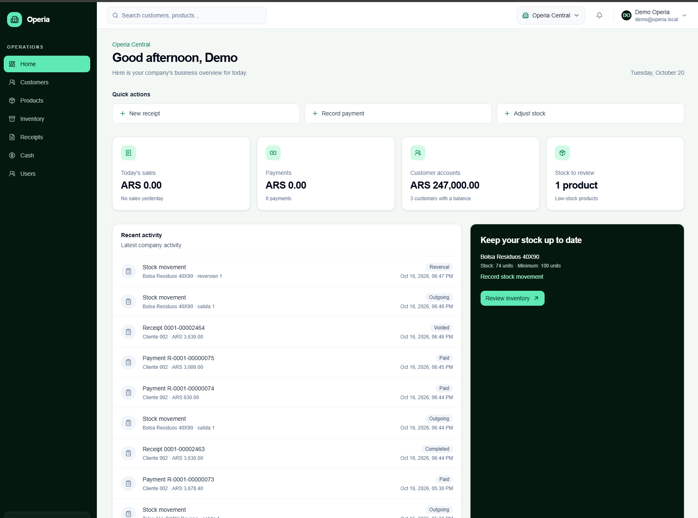
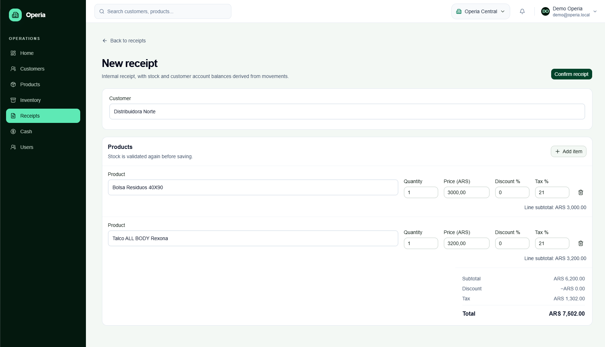
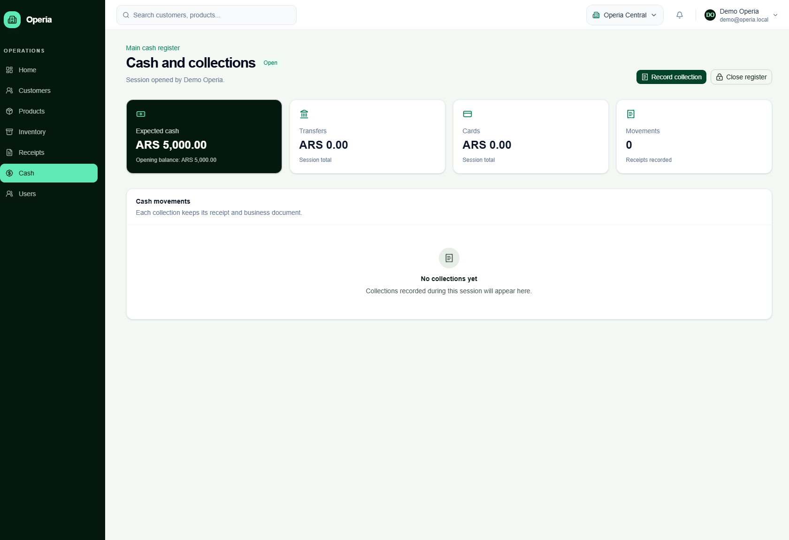
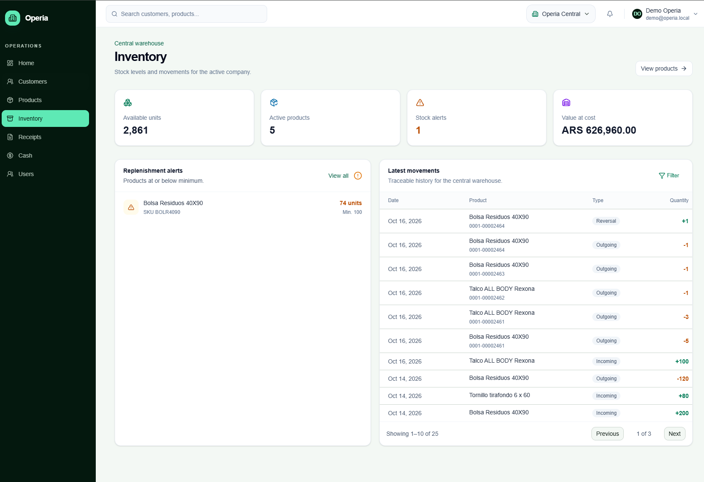

# Operia Web

**Multi-company back-office web app for small businesses: customers, products and stock, sales documents, cash register and customer accounts.**


> **ES:** Operia es una aplicación web de gestión comercial multiempresa: clientes, productos e inventario, comprobantes, caja y cuenta corriente. Funciona con datos de demostración locales o conectada a la API NestJS de Operia. La documentación principal está en inglés; las guías de uso y las decisiones técnicas en `docs/` están en español.

## Overview

Operia lets a small business run its day-to-day operations from one place: register customers, issue sales documents, collect payments, open and close the cash register, track stock and follow the day on a dashboard.

One installation serves several companies. A user can belong to more than one company and switches between them from the header; the active company comes from the server session and is never sent as business data.

This repository is the **web application**. It talks to the Operia API (NestJS + PostgreSQL), which lives in its own repository (see [Related](#related)).

## Screenshots

|                                                  |                                                  |
| ------------------------------------------------ | ------------------------------------------------ |
|      |  |
| **Dashboard:** daily summary and recent activity | **New receipt:** line items and live totals      |
|       |      |
| **Cash register:** open session and collections  | **Inventory:** stock alerts and movements        |

## Key features

- **Multi-company:** company switcher in the header; every screen works on the active company.
- **Customers and customer accounts:** CUIT validation, search, running balance and applied payments.
- **Products and inventory:** catalog with categories, stock movements, reversals and low-stock alerts.
- **Sales documents:** numbered documents with line items and totals; printable A4 layout and PDF export through the browser.
- **Cash register:** opening, partial collections, closing with declared vs. theoretical balance.
- **Notifications:** in-app bell and Telegram order linking.
- **Dashboard:** daily sales, collections, outstanding balances and recent activity.
- **Internationalization:** Spanish and English, resolved from cookie and `Accept-Language`.

## Tech stack

| Area         | Choice                                             |
| ------------ | -------------------------------------------------- |
| Framework    | Next.js 16 (App Router), React 19                  |
| Language     | TypeScript (strict)                                |
| Styling / UI | Tailwind CSS 4, shadcn/ui on Base UI, lucide icons |
| Data         | TanStack Query for reads and mutations             |
| Forms        | React Hook Form with Zod 4 schemas                 |
| i18n         | next-intl (es / en)                                |
| Testing      | Vitest                                             |
| Tooling      | pnpm 11, ESLint, Prettier, GitHub Actions          |

## Architecture

```text
src/app (routes and layouts)
        ↓
src/components (screens and client components)
        ↓
src/data (TanStack Query, commands and contracts)
        ├── src/data/http (Operia API)
        └── src/data/local (in-memory demo adapter)
                ↓
src/features/*/domain (pure rules) + AppStoreProvider (local state)
```

Components consume `useData()` and read hooks; they never know whether data comes from the API or from the local adapter. Both implement the same async interfaces and return a `Result<T>`, so a screen is written once and works in either mode.

## Engineering highlights

- **Swappable data layer:** `NEXT_PUBLIC_DATA_SOURCE=api|local` switches between the real API and a self-contained demo, with no change to screens or domain contracts.
- **Money as integer cents:** amounts are stored and exchanged in whole cents; balances and inventory are derived from movements, not stored as totals.
- **Pure domain rules:** allocation, settlement and stock rules live in `src/features/*/domain` and are unit tested without UI.
- **Validation at the edges:** Zod schemas parse API responses and form input.
- **Atomic local operations:** in demo mode, document changes and their effects on stock and customer account apply together, with idempotency and per-company isolation.
- **i18n parity:** a test fails if the Spanish and English catalogs differ in keys or ICU parameters.
- **Session handling:** the demo session cookie is `httpOnly`; in API mode the backend session is used.

Design notes: [implementation decisions](docs/decisions.md) and [API contract](docs/api-contract.md).

## Run locally

Requirements: Node.js 22+ and pnpm 11.

```bash
pnpm install
pnpm dev
```

Open <http://localhost:3000>. Set `NEXT_PUBLIC_DATA_SOURCE` in `.env.local` (see `.env.example`):

- `local`: demo data in memory, reset on reload; the demo login accepts any credentials.
- `api`: connects to the Operia API.

Other guides (Telegram linking, PDF export, adding a language): [docs/guides.md](docs/guides.md).

## Quality

```bash
pnpm format:check
pnpm lint
pnpm typecheck
pnpm test
pnpm build
```

GitHub Actions runs these checks on Node 22 and pnpm 11. Unit tests cover domain rules, schemas and local commands, including company isolation, idempotency, atomicity, cash register and cancellations. There are no end-to-end browser tests yet.

## Project status and roadmap

Actively developed demo project.

- Add browser end-to-end tests and published screenshots.
- Retire the remaining local adapters in favor of the API.

## Related

- [Operia API](https://github.com/MatiasOlivaRqta/operia_demo_api) (NestJS, Prisma, PostgreSQL)

## License

All rights reserved. Source available for viewing and evaluation only. See [LICENSE](LICENSE).

## Author

**Matias Oliva** — Full-stack developer (NestJS · TypeScript · PostgreSQL)

[LinkedIn](https://www.linkedin.com/in/matias-oliva-rqta) · [Email](mailto:matias.oliva.rqta@gmail.com)
